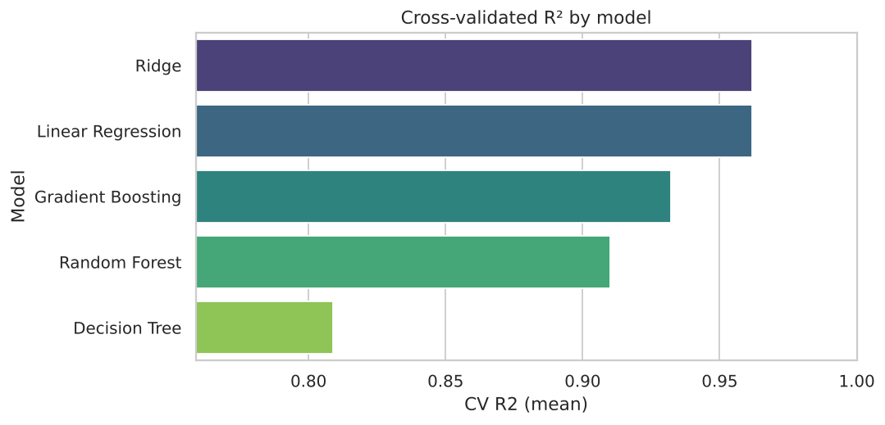
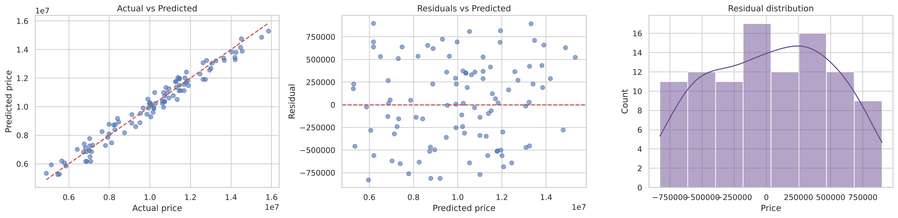

# 🏠 House Price Prediction — End-to-End Machine Learning

Predict house prices from physical features and amenities using a leak-free scikit-learn pipeline, cross-validated model selection and hyper-parameter tuning.

  

## 📌 Highlights

| | |
|---|---|
| **Best model** | Ridge Regression (selected by 5-fold CV, tuned with `GridSearchCV`) |
| **Test R²** | **0.967** (baseline "predict the mean": −0.05) |
| **Test MAE** | ≈ 397,700 — about **3.9 %** of the average price |
| **Overfitting check** | Train R² ≈ Test R² (gap ≈ 0) |
| **Top driver** | `Area_sqft`, then `Bedrooms` and `Bathrooms` |

## 🎯 Objective

Predict the selling price of a house from 12 features and identify which of them actually drive the price.

## 📂 Dataset

`data/House_Price_Prediction_Dataset.xlsx` — 500 houses × 13 columns, no missing values, no duplicates, no IQR outliers.

| Type | Features |
|---|---|
| Numeric | `Area_sqft`, `Bedrooms`, `Bathrooms`, `Stories`, `Parking` |
| Yes/No | `MainRoad`, `GuestRoom`, `Basement`, `HotWaterHeating`, `AirConditioning`, `PreferredArea` |
| Categorical | `FurnishingStatus` (Furnished / Semi-Furnished / Unfurnished) |
| **Target** | `Price` |

## 🔬 Methodology

1. **Data validation** – shape, dtypes, missing values, duplicates, IQR outlier check.
2. **EDA** – price/area distributions, price vs. every feature, annotated correlation heatmap.
3. **Train/test split (80/20)** – the test set is touched only once, at the end.
4. **Pipeline** – `ColumnTransformer` (StandardScaler for numeric, One-Hot for categorical) + model, so encoding is fitted on training data only and the model accepts **raw** input.
5. **Model comparison** – Linear, Ridge, Decision Tree, Random Forest, Gradient Boosting with 5-fold CV (R², RMSE, MAE).
6. **Tuning** – `GridSearchCV` on the best model family.
7. **Final evaluation** – test metrics, train-vs-test gap, mean-predictor baseline.
8. **Diagnostics** – actual-vs-predicted, residual plot, residual histogram.
9. **Interpretation** – permutation importance on the original columns.
10. **Deployment-style prediction** – predict a new house from raw values; model saved with `joblib`.

## 📊 Results

Cross-validation on the training set (5-fold):

| Model | CV R² | CV RMSE | CV MAE |
|---|---|---|---|
| **Ridge** | **0.962** | 482,492 | 419,255 |
| Linear Regression | 0.962 | 482,580 | 419,114 |
| Gradient Boosting | 0.93 | 644,938 | 530,235 |
| Random Forest | 0.91 | 740,980 | 610,492 |
| Decision Tree | 0.81 | 1,078,806 | 857,502 |

Simple linear models beat the tree-based ones because price in this dataset is almost linear in area.

<p align="center">
  
  
</p>
<p align="center">
  
</p>
<p align="center">
  
</p>

## 💡 Insights

- **Area is the dominant driver** (correlation 0.89 with price; median ≈ 3,400 per sq ft).
- Bedrooms and bathrooms add smaller but real signal.
- Amenities (guest room, basement, hot-water heating, furnishing, …) change average price by < 5 % and add almost nothing once size is known.
- Residuals are centred near zero with no visible pattern, so the linear model is a good fit.

## ⚠️ Limitations

- Only 500 rows; the data looks **synthetic** (very clean, near-linear, negligible amenity effects), so scores will not transfer to real listings without retraining.
- No location, house age or sale date; currency is not stated in the dataset.
- Predictions outside the training area range (605–4,992 sq ft) are unreliable.

## 🚀 Run it

```bash
git clone https://github.com/hemanthreddy2105/House-Price-Prediction-ML.git
cd House-Price-Prediction-ML
pip install -r requirements.txt
jupyter notebook House_Price_Prediction.ipynb   # Restart & Run All
```

Or open the notebook in Google Colab and upload `data/House_Price_Prediction_Dataset.xlsx` next to it.

Use the saved model:

```python
import joblib, pandas as pd
model = joblib.load("models/house_price_model.joblib")
house = pd.DataFrame([{"Area_sqft": 1600, "Bedrooms": 3, "Bathrooms": 2, "Stories": 1,
    "MainRoad": "Yes", "GuestRoom": "No", "Basement": "No", "HotWaterHeating": "No",
    "AirConditioning": "Yes", "Parking": 1, "PreferredArea": "Yes",
    "FurnishingStatus": "Semi-Furnished"}])
print(model.predict(house)[0])
```

## 📁 Project structure

```
House-Price-Prediction-ML/
├── House_Price_Prediction.ipynb   # full analysis with saved outputs
├── data/House_Price_Prediction_Dataset.xlsx
├── images/                        # figures generated by the notebook
├── models/house_price_model.joblib
├── requirements.txt
├── LICENSE
└── README.md
```

## 👨‍💻 Author

**Hemanth Reddy** — B.Sc. Economics (Data Science), Shiv Nadar University Chennai
GitHub: [@hemanthreddy2105](https://github.com/hemanthreddy2105)

If this helped you, consider giving it a ⭐!
