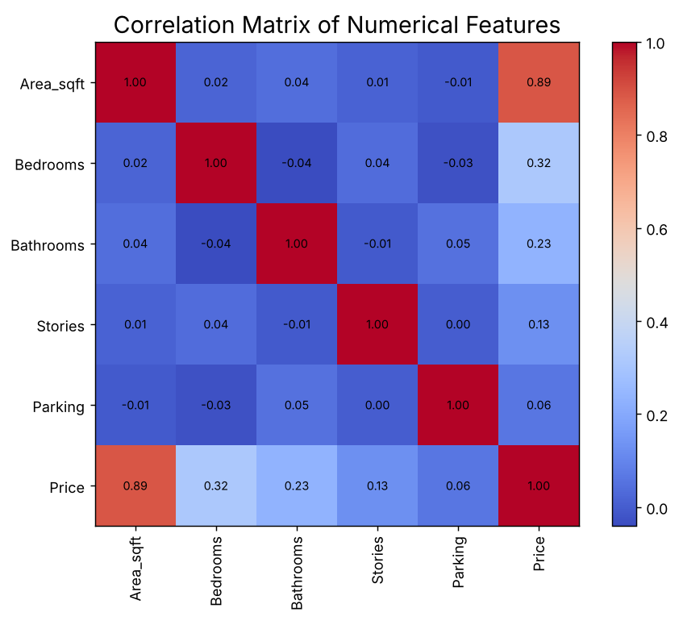
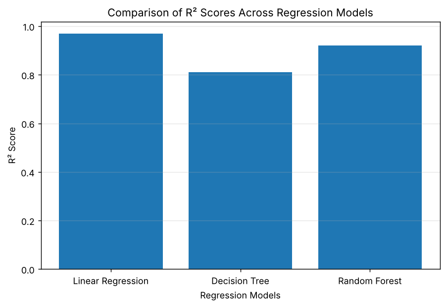
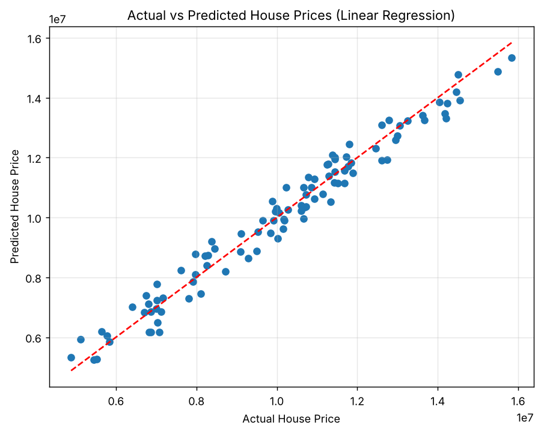
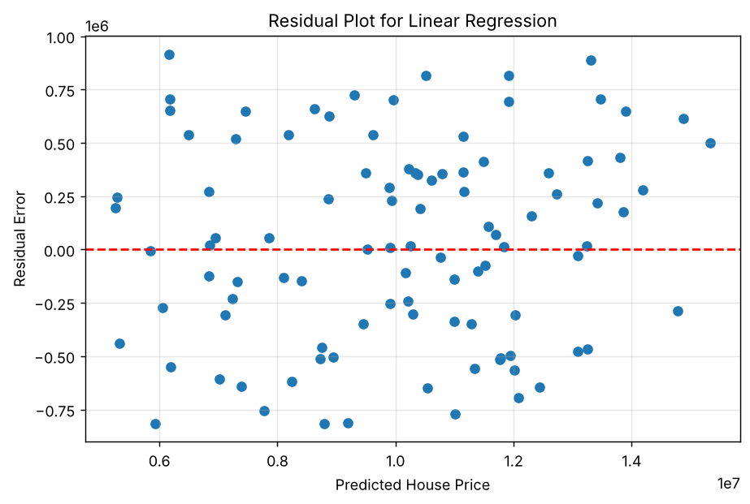
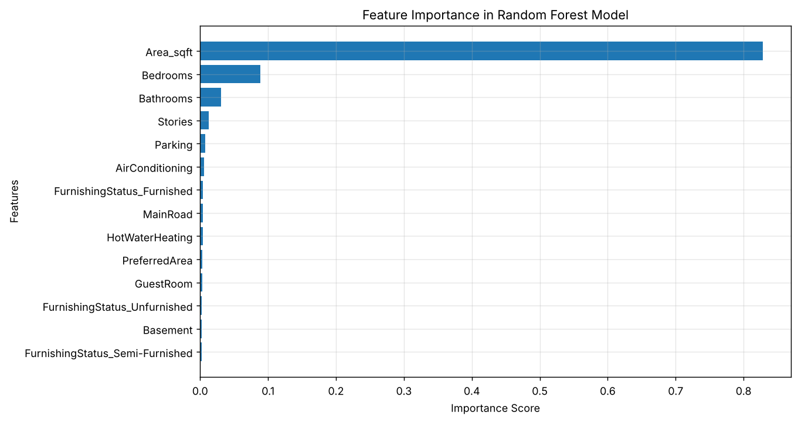

# 🏠 House Price Prediction Using Machine Learning

Predict house prices from property features by comparing three regression models (Linear Regression, Decision Tree, Random Forest).

  

## 📌 Highlights

| | |
|---|---|
| **Best model** | Linear Regression |
| **Test R²** | **0.967** |
| **Test MAE** | ≈ 396,600 (about 4 % of the average price) |
| **Top driver** | `Area_sqft` (≈ 83 % of Random Forest importance, correlation 0.89 with price) |

## 🎯 Objective

Predict the selling price of houses from features such as area, bedrooms, bathrooms, parking and furnishing status, and find out which features matter most.

## 📂 Dataset

`House_Price_Prediction_Dataset.xlsx` — 500 houses, 12 features + `Price`; no missing values and no duplicates.

- **Numeric:** Area_sqft, Bedrooms, Bathrooms, Stories, Parking
- **Yes/No:** MainRoad, GuestRoom, Basement, HotWaterHeating, AirConditioning, PreferredArea
- **Categorical:** FurnishingStatus (Furnished / Semi-Furnished / Unfurnished)
- **Target:** Price

## 🔬 Workflow

1. Data loading and understanding (shape, dtypes, statistics)
2. Data quality checks (missing values, duplicates)
3. Exploratory data analysis (distributions, scatter plots, annotated correlation matrix)
4. Preprocessing: Yes/No columns label-encoded, `FurnishingStatus` one-hot encoded (it has no natural order)
5. 80/20 train-test split (`random_state=42`)
6. Models: Linear Regression, Decision Tree, Random Forest
7. Evaluation with MAE, MSE, RMSE and R²; automatic best-model selection by R²
8. Feature importance (Random Forest)
9. Price prediction for a new house using the best model
10. Residual analysis, business insights and limitations

## 📊 Results

| Model | MAE | RMSE | R² |
|---|---|---|---|
| **Linear Regression** | **396,577** | **465,810** | **0.9674** |
| Random Forest | 594,094 | 737,383 | 0.9184 |
| Decision Tree | 902,338 | 1,129,136 | 0.8086 |

Linear Regression wins because price in this dataset is almost linear in area.

<p align="center">
  
  
</p>
<p align="center">
  
  
</p>
<p align="center">
  
</p>

## 💡 Insights

- Area is by far the strongest driver of price; bedrooms and bathrooms add a smaller effect.
- Amenities (guest room, basement, hot-water heating, air conditioning, furnishing) change the average price by only a few percent.
- Houses in preferred areas are *not* more expensive in this data (average is slightly lower).
- A simple linear model explains about 97 % of the variation in price.

## ⚠️ Limitations

- Only 500 rows, and the data looks synthetic (very clean, nearly linear), so scores will not transfer to real listings without retraining.
- No location, house age or sale date; currency is not stated.
- Predictions outside the training area range (about 600–5,000 sq ft) are unreliable.

## 🚀 Run it

```bash
git clone https://github.com/hemanthreddy2105/House-Price-Prediction-ML.git
cd House-Price-Prediction-ML
pip install -r requirements.txt
jupyter notebook House_pricing_analysis.ipynb   # Restart & Run All
```

Or open the notebook in Google Colab and upload `House_Price_Prediction_Dataset.xlsx` next to it.

## 📁 Project structure

```
House-Price-Prediction-ML/
├── House_pricing_analysis.ipynb        # full analysis (with outputs)
├── House_Price_Prediction_Dataset.xlsx
├── images/                             # figures saved by the notebook
├── requirements.txt
├── LICENSE
└── README.md
```

## 👨‍💻 Author

**Hemanth Reddy** — B.Sc. Economics (Data Science), Shiv Nadar University Chennai
GitHub: [@hemanthreddy2105](https://github.com/hemanthreddy2105)
